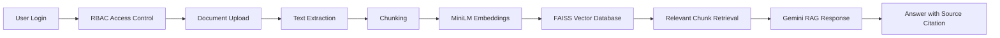

# Enterprise Documentation Q&A Assistant

A secure enterprise document intelligence application that allows users to upload documents, index them using embeddings, and ask grounded questions through a Retrieval Augmented Generation (RAG) chatbot.

The chatbot answers only from uploaded and indexed documents and displays the most relevant supporting source.

## Features

- Role-based authentication and access control
- Three roles: Admin, Editor, and Viewer
- Multi-format document upload
  - PDF
  - DOCX
  - TXT
  - Markdown
  - HTML
- Text extraction and document metadata storage
- Document preview, search, download, and deletion controls
- Heading-aware chunking
- SentenceTransformer embeddings
- FAISS vector database for semantic search
- Gemini-powered RAG chatbot
- Grounded responses based on retrieved document chunks
- Top-1 source citation with relevant excerpt
- Safe fallback for unsupported questions
- Admin-only document indexing and evaluation workflow

## Problem Statement

Enterprise employees often need information about policies, access procedures, configuration, billing, troubleshooting, and internal processes. This information is distributed across manuals, FAQs, policy documents, release notes, and support articles.

Searching manually through many documents takes time and may lead to outdated or unsupported answers.

This project provides a secure document Q&A assistant that retrieves relevant document passages and generates concise answers with source evidence.

## Architecture



## Technology Stack

| Component | Technology |
|---|---|
| Frontend | Streamlit |
| Backend | Python |
| Authentication | SQLite and password hashing |
| Database | SQLite |
| Document Parsing | PyPDF, python-docx, BeautifulSoup |
| Embedding Model | `sentence-transformers/all-MiniLM-L6-v2` |
| Vector Database | FAISS |
| LLM | Gemini Developer API |
| Environment Variables | python-dotenv |
| Testing | pytest |

## User Roles

| Role | Permissions |
|---|---|
| Admin | Manage users, upload documents, manage all documents, index documents, run evaluation, and use chat |
| Editor | Upload documents, manage permitted documents, index permitted documents, and use chat |
| Viewer | View permitted document content and use chat |

## Project Workflow

1. User logs in according to their assigned role.
2. Admin or editor uploads enterprise documents.
3. The application extracts text and stores document metadata.
4. Admin or editor indexes documents.
5. Text is divided into heading-aware chunks.
6. Each chunk is converted into a vector embedding.
7. FAISS stores the embeddings for fast semantic search.
8. User asks a natural-language question.
9. The system retrieves relevant chunks.
10. Gemini generates an answer using only retrieved document context.
11. The application shows the strongest supporting document source as `[S1]`.

## Folder Structure

```text
secure_doc_assistant/
│
├── .streamlit/
├── core/
├── data/
│   ├── uploads/
│   ├── extracted_text/
│   ├── vector_store/
│   ├── evaluation/
│   └── app.db
├── tests/
├── ui/
├── .env.example
├── .gitignore
├── app.py
├── requirements.txt
└── README.md
```

## Installation

```bash
git clone https://github.com/Amshish0712/your-repository-name.git
cd secure_doc_assistant
python -m venv .venv
```

### Windows PowerShell

```powershell
.venv\Scripts\Activate.ps1
pip install -r requirements.txt
Copy-Item .env.example .env
```

Open the `.env` file and add your Gemini API key:

```env
GEMINI_API_KEY=your_gemini_api_key_here
GEMINI_MODEL=gemini-3.1-flash-lite
```

Run the application:

```bash
streamlit run app.py
```

Open:

```text
http://localhost:8501
```

## Document Storage

| Data | Location |
|---|---|
| Original uploaded documents | `data/uploads/` |
| Extracted text | `data/extracted_text/` |
| SQLite database | `data/app.db` |
| FAISS vector index | `data/vector_store/index.faiss` |
| Evaluation files and reports | `data/evaluation/` |

## RAG Pipeline

```text
Question
→ Query Embedding
→ FAISS Similarity Search
→ Relevant Document Chunks
→ Gemini Prompt with Retrieved Context
→ Grounded Answer
→ Top Source Citation
```

## Example Questions

```text
How should sensitive paper records be disposed of?

How often must a manager review service coverage in a flexible work arrangement?

What approval steps are required for emergency access?

What is the cafeteria menu?
```

For unsupported questions, the application returns:

```text
I could not find enough information in the indexed documents to answer that.
```

## Security Notes

- API keys are stored only in the local `.env` file.
- `.env` must never be committed to GitHub.
- The application applies role-based access control before document retrieval.
- Users can access only documents allowed by their role and permissions.
- The chatbot does not use web search or external knowledge for answers.

## Future Enhancements

- Hybrid search using FAISS and BM25
- Cross-encoder reranking
- Automatic document summarization
- FAQ and quiz generation
- Document comparison
- Expanded evaluation dashboard
- Cloud deployment
- Audit logs and activity tracking

## Author

**Amit Ashish**  
25CSM2S11

## License

This project is developed for the HCLTech Future Ready AI Engineer Hackathon.
